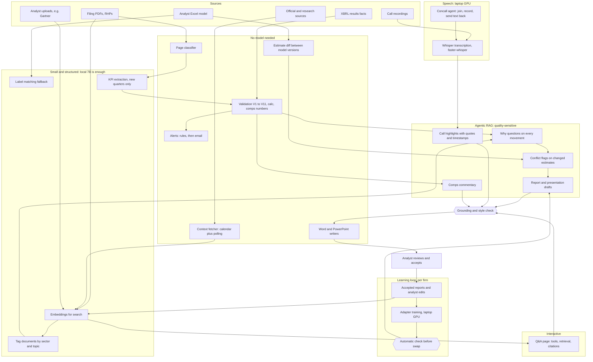

# AI in Analekh: the plan, what uses it, and where each job runs

Version 0.0.6 (29 October 2026). Goal: zero API cost where quality allows, and drafts that are
right on the first run because the system knows the current situation and the analyst's way of
writing. This file is a plan, not a record of what is built: today every language-model call goes
through `analekh/genai/client.py` (`Claude.create`), and there is no local provider, no context
fetcher and no training loop yet. The design is in design doc 17.3 to 17.6 and 3.4 (all
proposed); the overall order of work is in [docs/roadmap.md](docs/roadmap.md).

Legend: ✅ built · 🟡 partly built · 🔲 decided, not built · 💬 proposed, needs a decision

## 1. The plan in one page

**The problem it solves.** A first draft today knows the company's numbers but not the world
around them (rates, crude, policy, the sector). The analyst pastes that context in by hand and
rewrites the draft into their own voice. Both steps should go.

**Three parts** (owner, 29 October 2026):

| Part | What it does | Why |
|---|---|---|
| Agentic RAG | Before writing, an agent works out which context the company needs (a bank needs RBI policy; an oil marketer needs OPEC and fuel policy), retrieves it from documents already fetched, asks a fixed set of "why" questions of every movement, then drafts | Context comes from evidence, not memory; every claim cites a document |
| Context fetcher | Official and research sources are downloaded as soon as they publish (by calendar for scheduled events, by polling otherwise), parsed, tagged by sector and stored | The agent only retrieves; it never searches the web at draft time |
| Learning loop | The model's weights are retrained on what each firm and analyst accepts and edits, so drafts take on their tone, structure and framing | Each analyst's voice, learned rather than prompted |

**Weights learn how to write; retrieval holds what is true now.** Facts, numbers and the
current situation are never trained into the weights: they go stale and cannot be cited. Rule 3
holds unchanged: every number comes from a tool result or `calc`.

**Numbers are not the only evidence.** Every report weighs the analyst's numbers against macro,
policy, sector and management evidence.

## 2. Agentic report flow (proposed, not built)

1. Results arrive; the analyst approves the model changes (existing sync step, design doc 6.5).
2. The agent explains the movement in the approved numbers with standing "why" questions, for
   example: is it macro, sector-wide or company-specific; one-off or structural; will costs come
   down, and when; does management's commentary agree with the numbers. Each answer must cite a
   retrieved document; with no evidence it says so instead of reasoning from memory.
3. The analyst tweaks next year's estimates. The agent diffs the approved model before and after
   (`model_versions`, `ModelReader`, the driver detection in `workbook/reader.py`): every growth
   rate, cost line, margin and driver that moved, and by how much.
4. The agent tests each changed assumption against the evidence. **When the evidence points the
   other way, it flags the conflict to the analyst before drafting** (for example, cost growth cut
   while every official source says input costs are rising). The analyst keeps the estimate,
   changes the model, or adds a note. The agent never changes an estimate (rule 2, rule 8).
5. The draft explains the analyst's estimates and their reasoning with cited evidence, in the
   analyst's voice, section by section (the report outlines of design doc 17).
6. Grounding check, then style check (no em-dashes, no stock phrases), then the analyst's review.
   The analyst's edits and the accepted version feed the learning loop (section 4).

The control flow stays in code: the agent fills a fixed plan (sections, questions, sources per
sector) and the model reads and writes within it. No open-ended agent loops on a 7B model.

New tools for the model (beside `get_facts`, `get_kpis`, `get_model_values`, `search_filings`,
`get_prices`, `calc`): `search_context(sector, topic, since)` over the fetched sources,
`get_estimate_changes(model_id, from_version, to_version)` and `get_analyst_notes(company)` (the
analyst's earlier inputs and conflict answers).

## 3. Context sources and the fetch schedule

Each firm's instance fetches for itself; nothing is shipped centrally (owner, 29 October 2026: no
knowledge packs). Every host and its paths go into `ALLOWED_HOSTS` / `ALLOWED_PATHS` in
`analekh/ingest/http.py` only with the owner's approval (rule 1), recorded in `deviations.md`.
Fetching goes through `PoliteClient`: honest User-Agent, listing pages and the files they link
to, no crawling, no logins, nothing behind a paywall, and each site's terms read first.

| Source | Kind | What | How | State |
|---|---|---|---|---|
| RBI | Official | MPC statements and minutes, circulars, notifications, bulletins | Calendar for MPC decision days, daily poll of listing pages | 💬 host to approve |
| Government of India | Official | Policies, schemes, subsidies, mandates, gazette notifications (ministries named per sector) | Daily poll of listing pages | 💬 hosts to approve |
| OPEC | Intergovernmental | Monthly oil market report, press releases | Calendar plus weekly poll | 💬 host to approve |
| World Bank | Intergovernmental | Outlooks, commodity reports, data | Calendar plus weekly poll | 💬 host to approve |
| World Economic Forum | Public research | Reports | Weekly poll | 💬 host to approve |
| IBEF | Industry body | Sector reports | Weekly poll | 💬 host and terms to check |
| CRISIL, EY, McKinsey, BCG, Bain | Private research ("gold standard", owner, 29 October 2026) | Free public reports and PDFs only | Weekly poll | 💬 hosts and terms to check |
| Gartner | Private, paywalled | Reports the firm licenses | Analyst upload only, never fetched | 🔲 upload path exists |
| SEBI | Official | RHP and Prospectus | Daily (built, design doc 6.11) | ✅ |
| NSE | Exchange | Results, feeds, prices | Design doc 9 | ✅ |

**Scheduled events.** Releases whose dates are published in advance go on a calendar (a config
file, checked against each publisher's own calendar). On the day, the watcher polls that source
more often until the document is stored, the same way `analekh/seasons.py` runs the results
watcher hourly in season. Example: RBI's MPC schedule is published ahead; the decision statement
is expected on the meeting's last day, the minutes about two weeks later.

**Unscheduled items** (circulars, notifications, policies, reports) come from a poll of each
source's listing page, once or twice a day, or weekly for slower publishers.

**At ingest, not at draft time:** each document is stored once by hash (`ingest/storage.py`),
read (`docs/pdf.py`), chunked and embedded (`docs/embeddings.py`, local), and tagged with the
sectors, companies and topics it affects by a cheap overnight job on the local 7B. A draft for a
bank then retrieves RBI items by tag and date.

## 4. Learning from the analyst (proposed, after the MVP)

**What trains the model:** every report the analyst finally accepts, every edit between the draft
and the accepted version (the strongest signal), the analyst's answers to conflict flags, and
the analyst's notes and inputs. Retrieval also indexes the same material, so it helps the next
draft from day one, before any training run.

**How:** small adapter layers (LoRA, trained 4-bit as QLoRA) on top of a local base model, not
retraining the whole model, which 8 GB of GPU memory cannot do.

| Layer | Trained on | Gives |
|---|---|---|
| Firm layer | Accepted reports of every analyst in the firm | House structure, frameworks, how macro and policy are tied to a company |
| Analyst layer | One analyst's accepted reports and edits | That analyst's voice and emphasis; a few MB each, swapped per request |
| New analyst | Firm layer only, until enough accepted reports exist (a guess: 15 to 20) | |

**When:** training runs in the background as reports are accepted (nightly, or after every N
accepted reports). **Before a new adapter goes live, an automatic check** compares it with the
current one on a fixed set of the firm's past reports: grounding rejections, broken structured
output, banned phrasing, missing sections. If it is worse, it is not swapped in. The last few
adapters are kept for rollback. This needs no golden set and no human; the full golden-set test
comes later, after the MVP (owner, 29 October 2026). Hotfixes ship as usual.

**Order:** fine-tuning comes after the MVP's features are done. Retrieval and the agent come
first: they fix the "paste in current context" problem on day one.

## 5. Self-hosted, per firm (Analekh as a platform)

The end goal is a platform each firm runs locally (owner, 29 October 2026):

- Each firm's instance holds its own documents, edits, accepted reports and adapters. Its data
  trains only its own model. Nothing flows back to Analekh and nothing is shared between firms.
- Analekh ships the software and the base model. No client data and no knowledge packs.
- Each instance fetches its own sources (section 3) and can add sources of its own (with its own
  approval, as rule 1 requires here).
- A firm needs a GPU machine for training (about 8 GB of GPU memory for a 7B adapter; more for a
  14B). Without one it can still draft on CPU, slowly, but cannot train.
- Extra products and features come later as add-ons or sister products (roadmap section 8).

## 6. Rules that apply whatever the model

- Generated text may only contain numbers from tool results or `calc`. `genai/grounding.py`
  blocks anything else. A weaker model will trip it more often: do not weaken the check.
- XBRL wins over AI-extracted values (V10). A local model's KPI never overrides a filed fact.
- Ratings and target prices come from the analyst. No model proposes one, and training never
  teaches one: accepted reports' ratings are masked out of training data.
- Drafts must read as the analyst's own work: no em-dashes. An output filter runs for every model.
- The analyst approves before anything is written to a model or sent out. Estimates are the
  analyst's: the agent explains and flags, never changes them.
- Guardrails are code in front of every model, so no training run can remove them.

## 7. Hardware

| Machine | Spec | Always on | Good for |
| --- | --- | --- | --- |
| VM | 4 vCPU, 24 GB RAM, no GPU | yes | web app, Postgres, MinIO, Celery, NSE ingest, context fetcher, CPU jobs |
| Laptop | RTX 4060 8 GB | no | Whisper, 7B to 8B models fully on the GPU, 14B with partial offload, adapter training |
| Claude API | hosted | yes | anything where local quality is not good enough yet |
| Phone (OnePlus 13, 12 GB) | Snapdragon 8 Elite | no | personal offline use only (PocketPal, Qwen2.5 3B); not part of the deployment |

Models already on hand (Ollama): Qwen2.5 and DeepSeek-R1, 7B and 8B. Speeds below are estimates,
not measurements. Benchmark on the real machines before relying on them.

## 8. Flow

## 9. Where each job can run

| Job | Status in code | VM CPU (Qwen2.5 7B, about 2 to 4 tok/s) | Laptop 4060 (7B about 30 to 50 tok/s, 14B about 8 to 12) | Claude API | Suggested |
| --- | --- | --- | --- | --- | --- |
| Context fetcher (calendar, polling, parse, embed) | not built | yes, no model | not needed | not needed | VM |
| Document tagging (sector, company, topic) | not built | yes, overnight | yes | yes | VM CPU queue |
| Label matching fallback | built (`genai/labels.py`, small model) | yes | yes | yes | VM, overnight is fine |
| Embeddings | built, already local (`docs/embeddings.py`) | yes | yes | not needed | VM, keep local |
| KPI extraction, new quarters | built (`docs/extract.py`) | yes, queue it | yes | yes | VM CPU queue, or laptop |
| Backfill extraction | built, not needed now | no | no | batch API | skip |
| Whisper transcription | built (`docs/audio.py`) | `small` or `base` only, slow | `large-v3` fits, faster than real time | not applicable | laptop |
| Concall agent (join, record, relay) | not built | scripted join is fine; no live speed | yes, laptop must stay on for the call | not needed | laptop, Playwright script for login |
| Estimate diff and conflict flags | not built (diff is code; flags need the model) | batch | yes, 7B | yes | laptop 7B |
| Results analysis narrative ("why" questions) | built as report kinds (`genai/reports.py`) | slow but fine as a batch | yes, 7B | yes | laptop 7B, Claude as fallback |
| Call highlights | not built (page shows "Not generated yet") | too slow live | yes, 7B on rolling chunks | yes | laptop; check quote accuracy first |
| Report and presentation drafts | built (flash, note, initiation; IPO sections) | overnight only | 14B partial offload, plainer than Claude | yes | Claude until local drafts pass review |
| Word and PowerPoint files | built (`genai/writers.py`), code not AI | yes | yes | not needed | VM |
| Comps commentary | no AI in `ib/` yet | batch | yes | yes | same model as drafts |
| Adapter training (firm, analyst) | not built | no | yes, 7B QLoRA | not applicable | laptop GPU, nightly |
| Alerts | built (`alerts/`), rules only | yes | yes | not needed | VM, no model |
| Q&A page | built (`genai/qa.py`) | too slow for live answers | yes, but only while the laptop is on; 7B is weak over several tool steps | yes | Claude, or simple lookups on laptop |

## 10. Local setup notes

- Ollama on the VM and on the laptop. Models in hand: Qwen2.5 7B and DeepSeek-R1 8B.
- Qwen2.5 7B for extraction, labels, tagging, structured output and grounded text. Ollama's
  `format` option takes a JSON schema.
- DeepSeek-R1 8B only for a second pass on hard cases. It writes a long reasoning trace first,
  which is slow on CPU and poor for strict JSON.
- Adapters: Ollama loads a LoRA adapter through a Modelfile (`ADAPTER`), one model entry per
  adapter; a server that swaps adapters per request (vLLM's multi-LoRA) is the builder's choice
  if many analysts share one GPU.
- Set `OLLAMA_NUM_PARALLEL=1` and `OLLAMA_MAX_LOADED_MODELS=1` on the VM.
- Run local-model jobs on their own Celery queue with concurrency 1, so they never starve the
  API or the NSE watcher.
- Link the laptop to the VM over a private tunnel (Tailscale or WireGuard). Ollama has no login:
  never expose it on the open internet. Keep the VM's CPU model as the fallback when the laptop
  is off.
- The NSE-facing jobs stay on the VM (rule 1 needs an Indian network).

## 11. Before moving a job off Claude

1. Run it on a few golden-set filings and compare with the XBRL facts and the owner's marks.
2. Count grounding rejections and failed schema outputs.
3. Time it on the real machine and record tokens per second here.
4. Add the provider switch in `genai/client.py`, with a `deviations.md` entry.

Suggested order: labels and tagging, then new-quarter KPI extraction, then results analysis and
call highlights, then drafts and comps commentary, then Q&A last.

## 12. Recommended course (no API cost)

**Decision:** a hybrid. The VM is the always-on brain. The laptop's 4060 is an optional GPU worker
for speech, drafting and training. Nothing needs Claude, and nothing needs a paid GPU.

| Layer | Runs on | Why |
| --- | --- | --- |
| Web app, database, NSE and SEBI ingest, context fetcher, bhavcopy, alerts, writers | VM | always on, Indian network, no model |
| Label matching, KPI extraction (new quarters), document tagging, embeddings | VM, Qwen2.5 7B on CPU, overnight queue | small structured jobs, slow is fine |
| Whisper transcription, concall recording | Laptop 4060 | GPU speed; the call has to be captured live |
| Agentic drafts, conflict flags, call highlights, comps commentary | Laptop 7B (14B for drafts) when on; VM 7B overnight when off | quality needs the bigger model |
| Adapter training and the automatic check | Laptop 4060, nightly | needs a GPU |
| Q&A page | Laptop 7B when on; otherwise unavailable or the simple lookups only | interactive and multi-step, weakest with a 7B |

**What not to do**
- Do not build open-ended agents on a 7B model. Keep the control flow in code and use the model
  only to read text and return a schema.
- Do not train facts into the weights. Facts live in retrieval, with citations.
- Do not expose Ollama to the internet. Use a private tunnel.
- Do not run the 14B and the 7B at once on the laptop, or train while drafting. One job at a time.
- Do not move NSE-facing jobs to the laptop. Rule 1 needs the VM.
- Do not fetch from a source before its host and paths are approved and its terms read.

**Honest limits**
- Speeds on the 4060 and the VM are estimates until measured.
- Local draft quality is the open question. Keep the human review step and the grounding check.
- How much an adapter learns from 15 to 20 reports is unknown until tried.
- The laptop is off sometimes, so anything the analyst needs live has a fallback or waits.

## 13. Deployment guide

Work through the phases in order. Each phase has a check; do not move on until it passes.

### Phase A: Ollama on the VM (CPU)

1. Confirm the VM OS and that Ollama runs as a service.
2. Set the environment for the Ollama service (systemd override on Linux):
   `OLLAMA_HOST=127.0.0.1:11434`, `OLLAMA_NUM_PARALLEL=1`, `OLLAMA_MAX_LOADED_MODELS=1`,
   `OLLAMA_KEEP_ALIVE=10m`. Keep the host on localhost.
3. Pull the models: `ollama pull qwen2.5:7b`. Check the exact tag with `ollama list`.
4. **Check:** `ollama run qwen2.5:7b --verbose "Reply with OK"` returns, and the tokens per second
   line is recorded here (expect about 2 to 4).
5. Watch memory under load with `free -h`. The model plus the database and API must stay under
   about 20 GB.

### Phase B: Ollama on the laptop (GPU)

1. Install Ollama and confirm the NVIDIA driver is current: `nvidia-smi` shows the 4060.
2. Pull the models: `ollama pull qwen2.5:7b`, `ollama pull qwen2.5:14b`, and DeepSeek-R1 8B only
   for second-pass checks.
3. **Check:** `ollama run qwen2.5:7b --verbose "Reply with OK"` reports the GPU in use
   (`ollama ps` shows `GPU`). Record tokens per second (expect about 30 to 50 for 7B).
4. Test 14B. If `ollama ps` shows a CPU share, it is partly offloaded; note the speed.
5. Keep the laptop plugged in and not in sleep during a call or a training run.

### Phase C: Private link from VM to laptop

1. Install Tailscale on both machines and sign in with the same account.
2. On the laptop, set Ollama to listen on the Tailscale interface only:
   `OLLAMA_HOST=<laptop-tailscale-ip>:11434`, then restart Ollama.
3. **Check:** from the VM, `curl http://<laptop-tailscale-ip>:11434/api/tags` lists the models.
   Confirm it fails from any other network.
4. Do not open a port on the router. Do not add a password-less public address.

### Phase D: Application changes (not yet built)

These are code changes, each needing a `deviations.md` entry and tests:

1. **Provider switch in `analekh/genai/client.py`:** a `local` provider that calls Ollama's
   HTTP API with a JSON schema for structured output. Keep the same token logging into
   `llm_calls`, with a `provider` column or a tag. The grounding check and refusal handling stay
   in front of every provider.
2. **Settings in `analekh/config.py`:** `llm_provider` (`local`, `local_gpu_first`), Ollama host
   for each machine, and the model and adapter tags. No literals in code.
3. **Routing:** prefer the laptop when reachable, fall back to the VM CPU model, and mark the job
   as "waiting for laptop" when neither is up.
4. **Queues:** a Celery queue `local_llm` with concurrency 1 on the VM. Start the worker with
   `celery -A analekh.jobs.app worker -Q local_llm -c 1` (confirm the app path in
   `analekh/jobs/app.py` first).
5. **Output filter:** a no-em-dash check for drafts, before the grounding check.

### Phase E: Quality gate before trusting a job

1. Pick 5 to 10 filings from the golden set (`tests/fixtures/golden/`, gitignored).
2. Run the job on each. Count grounding rejections, schema failures and wrong values against the
   XBRL facts and the owner's marks.
3. Accept the job locally only if rejections stay low and no value is wrong. Otherwise keep it on
   Claude, or keep it on the laptop with a human check.
4. Record the result in this file: date, model tag, filings tested, failures.

### Phase F: Operating it

- Check the laptop link at the start of each job, not only at boot.
- Keep the VM's local model queue separate so NSE ingest is never blocked.
- Keep the backup scope in mind: Postgres and MinIO hold the filings and context documents the
  local model reads, and the adapters.
- Re-run Phase E after any model pull, since a new tag can change output.

### Phase G: Context sources (not yet built)

1. For each source in section 3: list the exact host and paths, read its terms, get the owner's
   approval, add it to `ALLOWED_HOSTS` / `ALLOWED_PATHS`, record it in `deviations.md`.
2. A source adapter per publisher (listing page parser, file link check against the allow-list),
   a `context_documents` record (source, published date, URL, hash, sectors, topics), and the
   calendar file for scheduled releases.
3. Beat entries per source, at the cadence in section 3; scheduled days poll more often.
4. Tagging job on the `local_llm` queue; chunks and embeddings as for filings.
5. **Check:** a week of runs stores each new release once, with no request outside the allow-list.

### Phase H: Agentic drafting (not yet built)

1. The tools `search_context`, `get_estimate_changes`, `get_analyst_notes`.
2. The fixed plan per report: sections, "why" questions per section, sources per sector.
3. The conflict screen: flags shown before drafting; the analyst's answer is stored.
4. Store the draft and the accepted version of every report, with the analyst's edits.
5. **Check:** drafts on 5 companies need no pasted context; every context claim cites a document.

### Phase I: Learning loop (after the MVP)

1. Training data builder: accepted reports and draft-to-final edits per firm and analyst, with
   ratings, target prices and numbers masked.
2. QLoRA training job on the laptop GPU; adapters versioned and stored per firm and analyst.
3. The automatic check before an adapter goes live; keep the last few for rollback.
4. **Check:** a new adapter is swapped in only when it is no worse on the fixed set.

### Order of work

1. Phases A and B: models running, speeds recorded.
2. Phase C: link working.
3. Phase E on labels and KPI extraction: smallest and most structured, safest first.
4. Phase D: provider switch and queues, only after step 3 passes.
5. Phase G: the first official sources (RBI, Government of India, OPEC, World Bank), then the rest.
6. Phase H: agentic drafting with conflict flags; results narrative and call highlights first.
7. Whisper and the concall agent, already partly built; add the scripted join.
8. Drafts, comps commentary, then Q&A last.
9. Phase I: the learning loop, once the MVP's features are done.

## 14. Open questions

- How the accepted version of a report comes back: an upload of the analyst's final Word file, or
  edits made in the web app.
- Exact hosts and paths for each source in section 3, and each one's terms (owner's approval).
- Which ministries and portals count as "Government of India" for each sector.
- Whether to ship a starter adapter trained only on public material, or start each firm from the
  base model.
- Minimum accepted reports before an analyst gets their own adapter.
