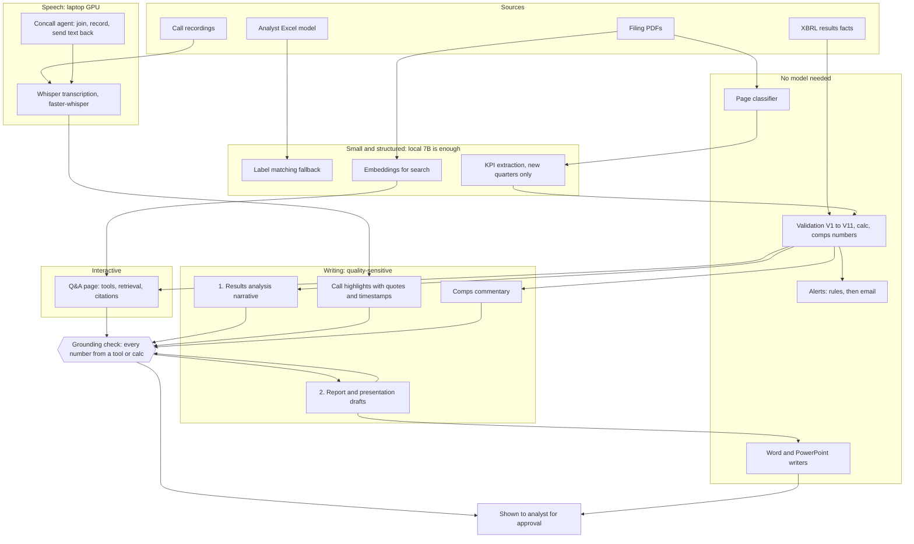

# AI in Analekh: what uses it, and where each job can run

Goal: zero API cost where quality allows. This file maps every AI use to the places it can run.
It is a plan, not a record of what is built: today every language-model call goes through
`analekh/genai/client.py` (`Claude.create`), and there is no local provider switch yet. Adding one
is a departure from the design doc and needs an entry in `docs/design/deviations.md`.

## Hardware

| Machine | Spec | Always on | Good for |
| --- | --- | --- | --- |
| VM | 4 vCPU, 24 GB RAM, no GPU | yes | web app, Postgres, MinIO, Celery, NSE ingest, CPU jobs |
| Laptop | RTX 4060 8 GB | no | Whisper, 7B to 8B models fully on the GPU, 14B with partial offload |
| Claude API | hosted | yes | anything where local quality is not good enough yet |

Speeds below are estimates, not measurements. Benchmark on the real machines before relying on them.

## Flow

## Where each job can run

| Job | Status in code | VM CPU (Qwen2.5 7B, about 2 to 4 tok/s) | Laptop 4060 (7B about 30 to 50 tok/s, 14B about 8 to 12) | Claude API | Suggested |
| --- | --- | --- | --- | --- | --- |
| Label matching fallback | built (`genai/labels.py`, small model) | yes | yes | yes | VM, overnight is fine |
| Embeddings | built, already local (`docs/embeddings.py`) | yes | yes | not needed | VM, keep local |
| KPI extraction, new quarters | built (`docs/extract.py`) | yes, queue it | yes | yes | VM CPU queue, or laptop |
| Backfill extraction | built, not needed now | no | no | batch API | skip |
| Whisper transcription | built (`docs/audio.py`) | `small` or `base` only, slow | `large-v3` fits, faster than real time | not applicable | laptop |
| Concall agent (join, record, relay) | not built | scripted join is fine; no live speed | yes, laptop must stay on for the call | not needed | laptop, Playwright script for login |
| 1. Results analysis narrative | built as report kinds (`genai/reports.py`) | slow but fine as a batch | yes, 7B | yes | laptop 7B, Claude as fallback |
| Call highlights | not built (page shows "Not generated yet") | too slow live | yes, 7B on rolling chunks | yes | laptop; check quote accuracy first |
| 2. Report and presentation drafts | built (flash, note, initiation) | overnight only | 14B partial offload, plainer than Claude | yes | Claude until local drafts pass your review |
| 3. Word and PowerPoint files | built (`genai/writers.py`), code not AI | yes | yes | not needed | VM |
| Comps commentary | no AI in `ib/` yet | batch | yes | yes | same model as drafts |
| Alerts | built (`alerts/`), rules only | yes | yes | not needed | VM, no model |
| 5. Q&A page | built (`genai/qa.py`) | too slow for live answers | yes, but only while the laptop is on; 7B is weak over several tool steps | yes | Claude, or simple lookups on laptop |

## Rules that apply whatever the model

- Generated text may only contain numbers from tool results or `calc`. `genai/grounding.py`
  blocks anything else. A weaker model will trip it more often: do not weaken the check.
- XBRL wins over AI-extracted values (V10). A local model's KPI never overrides a filed fact.
- Ratings and target prices come from the analyst. No model proposes one.
- Drafts must read as the analyst's own work: no em-dashes. Add an output filter for local models.
- The analyst approves before anything is written to a model or sent out.

## Local setup notes

- Ollama on the VM and on the laptop. Models in hand: Qwen2.5 7B and DeepSeek-R1 8B.
- Qwen2.5 7B for extraction, labels, structured output and grounded text. Ollama's `format`
  option takes a JSON schema.
- DeepSeek-R1 8B only for a second pass on hard cases. It writes a long reasoning trace first,
  which is slow on CPU and poor for strict JSON.
- Set `OLLAMA_NUM_PARALLEL=1` and `OLLAMA_MAX_LOADED_MODELS=1` on the VM.
- Run local-model jobs on their own Celery queue with concurrency 1, so they never starve the
  API or the NSE watcher.
- Link the laptop to the VM over a private tunnel (Tailscale or WireGuard). Ollama has no login:
  never expose it on the open internet. Keep the VM's CPU model as the fallback when the laptop
  is off.
- The NSE-facing jobs stay on the VM (rule 1 needs an Indian network).

## Before moving a job off Claude

1. Run it on a few golden-set filings and compare with the XBRL facts and the owner's marks.
2. Count grounding rejections and failed schema outputs.
3. Time it on the real machine and record tokens per second here.
4. Add the provider switch in `genai/client.py`, with a `deviations.md` entry.

Suggested order: labels, then new-quarter KPI extraction, then results analysis and call
highlights, then drafts and comps commentary, then Q&A last.

## Recommended course (no API cost)

**Decision:** a hybrid. The VM is the always-on brain. The laptop's 4060 is an optional GPU worker
for the speech and quality-heavy jobs. Nothing needs Claude, and nothing needs a paid GPU.

| Layer | Runs on | Why |
| --- | --- | --- |
| Web app, database, NSE ingest, bhavcopy, alerts, Word and PowerPoint writers | VM | always on, Indian network, no model |
| Label matching, KPI extraction (new quarters), embeddings | VM, Qwen2.5 7B on CPU, overnight queue | small structured jobs, slow is fine |
| Whisper transcription, concall recording | Laptop 4060 | GPU speed; the call has to be captured live |
| Results narrative, call highlights, drafts, comps commentary | Laptop 7B (14B for drafts) when on; VM 7B overnight when off | quality needs the bigger model, so the laptop is preferred |
| Q&A page | Laptop 7B when on; otherwise unavailable or the simple lookups only | interactive and multi-step, weakest with a 7B |
| Concall agent | Laptop: Playwright script for login and join, Whisper for audio, 7B for rolling summary | agents stay scripted, not free-roaming LLM loops |

**What not to do**
- Do not build open-ended agents on a 7B model. They fail often. Keep the control flow in code
  and use the model only to read text and return a schema.
- Do not expose Ollama to the internet. Use a private tunnel.
- Do not run the 14B and the 7B at once on the laptop. One model at a time.
- Do not move NSE-facing jobs to the laptop. Rule 1 needs the VM.

**Honest limits**
- Speeds on the 4060 and the VM are estimates until measured.
- Local draft quality is the open question. Keep the human review step, and the grounding check.
- The laptop is off sometimes, so anything the analyst needs live has a fallback or waits.

## Deployment guide

Work through the phases in order. Each phase has a check; do not move on until it passes.

### Phase A: Ollama on the VM (CPU)

1. Confirm the VM OS and that Ollama runs as a service.
2. Set the environment for the Ollama service (systemd override on Linux, system variables on
   Windows): `OLLAMA_HOST=127.0.0.1:11434`, `OLLAMA_NUM_PARALLEL=1`,
   `OLLAMA_MAX_LOADED_MODELS=1`, `OLLAMA_KEEP_ALIVE=10m`. Keep the host on localhost.
3. Pull the models: `ollama pull qwen2.5:7b`. Check the exact tag with `ollama list`.
4. **Check:** `ollama run qwen2.5:7b --verbose "Reply with OK"` returns, and the tokens per second
   line is recorded here (expect about 2 to 4).
5. Watch memory under load with `free -h`. The model plus the database and API must stay under
   about 20 GB.

### Phase B: Ollama on the laptop (GPU)

1. Install Ollama and confirm the NVIDIA driver is current: `nvidia-smi` shows the 4060.
2. Pull the models: `ollama pull qwen2.5:7b`, `ollama pull qwen2.5:14b`, and DeepSeek-R1 8B only
   for second-pass checks.
3. **Check:** `ollama run qwen2.5:7b --verbose "Reply with OK"` reports the GPU in use (look for
   the model loading onto the GPU, and `ollama ps` shows `GPU`). Record tokens per second
   (expect about 30 to 50 for 7B).
4. Test 14B. If `ollama ps` shows a CPU share, it is partly offloaded; note the speed.
5. Keep the laptop plugged in and not in sleep during a call. Disable sleep on AC power.

### Phase C: Private link from VM to laptop

1. Install Tailscale on both machines and sign in with the same account.
2. On the laptop, set Ollama to listen on the Tailscale interface only:
   `OLLAMA_HOST=<laptop-tailscale-ip>:11434`, then restart Ollama.
3. **Check:** from the VM, `curl http://<laptop-tailscale-ip>:11434/api/tags` lists the models.
   Confirm it fails from any other network.
4. Do not open a port on the router. Do not add a password-less public address.

### Phase D: Application changes (not yet built)

These are code changes, each needing a `deviations.md` entry and tests:

1. **Provider switch in `analekh/genai/client.py`:** a `local` provider that calls Ollama's
   HTTP API with a JSON schema for structured output. Keep the same token logging into
   `llm_calls`, with a `provider` column or a tag. The grounding check and refusal handling stay
   in front of every provider.
2. **Settings in `analekh/config.py`:** `llm_provider` (`local`, `local_gpu_first`), Ollama host
   for each machine, and the model tags. No literals in code.
3. **Routing:** prefer the laptop when reachable, fall back to the VM CPU model, and mark the job
   as "waiting for laptop" when neither is up.
4. **Queues:** a Celery queue `local_llm` with concurrency 1 on the VM. Start the worker with
   `celery -A analekh.jobs.app worker -Q local_llm -c 1` (confirm the app path in
   `analekh/jobs/app.py` first).
5. **Output filter:** a no-em-dash check for drafts, before the grounding check.

### Phase E: Quality gate before trusting a job

1. Pick 5 to 10 filings from the golden set (`tests/fixtures/golden/`, gitignored).
2. Run the job on each. Count grounding rejections, schema failures and wrong values against the
   XBRL facts and the owner's marks.
3. Accept the job locally only if rejections stay low and no value is wrong. Otherwise keep it on
   Claude, or keep it on the laptop with a human check.
4. Record the result in this file: date, model tag, filings tested, failures.

### Phase F: Operating it

- Check the laptop link at the start of each job, not only at boot.
- Keep the VM's local model queue separate so NSE ingest is never blocked.
- Keep the backup scope in mind: Postgres and MinIO hold the filings the local model reads.
- Re-run Phase E after any model pull, since a new tag can change output.

### Order of work

1. Phase A and B: models running, speeds recorded.
2. Phase C: link working.
3. Phase E on labels and KPI extraction: smallest and most structured, safest first.
4. Phase D: provider switch and queues, only after step 3 passes.
5. Results narrative and call highlights on the laptop.
6. Whisper and the concall agent, already partly built; add the scripted join.
7. Drafts, comps commentary, then Q&A last.
