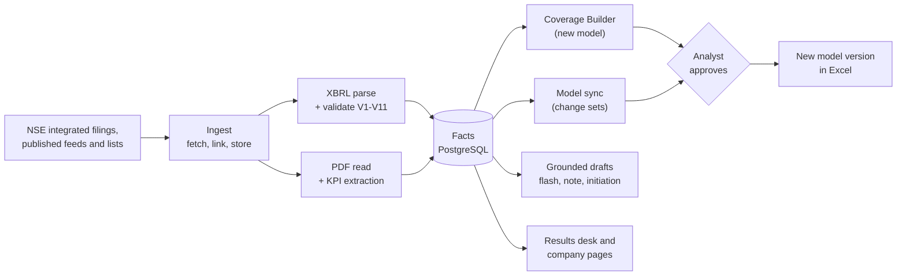

<h1 align="center">Analekh</h1>

<p align="center">
  <b>NSE results in, analyst-approved Excel models and grounded research drafts out.</b>
</p>

<p align="center">
  
  
  
  
  
  
</p>

Pick any NSE-listed company. Analekh finds its results filings, extracts and validates the
numbers, builds a model from your own template (or updates the model you already keep), writes
to Excel only after you approve, and drafts the results flash, earnings note, initiation, slides
and comps with every number traced to its source.

> **Design document:** *Analekh Technical Design Document v0.0.6*
> ([docs/design/technical-design.md](docs/design/technical-design.md); formatted copy
> `docs/design/Analekh - Technical Design v0.0.6.docx`, diagrams of every workflow
> `docs/design/Analekh - Architecture v0.0.6.pdf`). Section numbers in code comments (e.g.
> "design doc 12.3") refer to it; departures since are logged in
> [docs/design/deviations.md](docs/design/deviations.md).
>
> **Versions** follow the build phases: v0.0.x during Phase 0, v0.1.x once Phase 0 is complete,
> v0.2.x once Phase 1 is complete, and so on. The first release for proper testing is
> v1.0.0-pre-release.
>
> **Source control:** GitLab is the source of truth. GitHub is a read-only mirror, updated by CI
> after a green pipeline on `main` (design doc 22.5). Never push to GitHub directly.

## Contents

- [How it works](#how-it-works)
- [Status](#status)
- [Quick start](#quick-start)
- [Development](#development)
- [CI/CD](#cicd)
- [Data rules](#data-rules)

## How it works



- **XBRL wins** over AI-extracted values, and contexts are matched by dates, never by id.
- **The newest filing wins** when a company refiles a quarter; the older numbers are kept as
  history, and the company page tags the quarter Restated or Revised with what changed.
- **Nothing touches a model without approval**, and every write saves a new version; the
  original workbook is never overwritten.
- **Generated text may only contain numbers** from tool results or `calc`; a grounding check
  blocks anything else.

## Status

**v0.0.6, status on 29 October 2026.** The plan, the new ideas and what each one needs are in
[docs/roadmap.md](docs/roadmap.md); the AI plan (agentic RAG over official and research sources,
local models, learning from each firm's accepted reports) is in [AI.md](AI.md).

Since 21 October: sign-in, roles and model locks; the stack runs on the Oracle Cloud Mumbai VM
(deployed from GitLab, database and files restored, nightly database backup); CI runs on the VM's
own runners; margins by company type (EBITDA, NIM, core pre-provision profit) and interest ratios
for lenders; the Excel bridge links and scans a real workbook; IPO coverage from SEBI's RHP and
Prospectus lists; the security audit's fixes. The v0.0.6 design document is compact: current
design only, with repository files referenced instead of copied.

The data layer runs on real NSE data (counts as of 21 October 2026, the last full count):

| | |
|---|---|
| Companies in the universe | 3,186 (2,606 main board + 580 SME) |
| Companies with results stored | **2,756** (both backfills finished) |
| Results filings / values | **54,350 filings, 10.1 million values**, both bases |
| History | From **March 2023** (NSE's older files are incomplete); 1,567 companies have 14 or more quarters |
| Unit check (V11) | 28 filings tagged in the wrong unit corrected; **44 suspects** blocked until checked against their PDFs (the only blocked filings) |
| September 2026 quarter (Q2 FY27) | 169 companies reported by 21 October |
| Daily prices | NSE's bhavcopy after each close; 21 October loaded (3,065 companies); only the latest day is kept |
| Scheduler | Celery beat, worker and Redis in Docker: results watcher by season, prices, feeds |
| Sectors | **NSE's own taxonomy** for 1,430 companies (22 sectors), a sector of some source for 3,017 (LSEG-to-NSE mapping awaits the owner), none for 169 |
| Storage | About 5.4 GB (PostgreSQL 4.6 GB, raw files 0.8 GB with XBRL compressed) |

Results come from NSE's integrated-filing lookup (the results feed stopped on 24 August 2026)
and, for 2023-2024, its financial-results list. Banks, NBFCs, general insurers (reinsurers
included) and life insurers are read in their own formats and tie out. Home is a Results desk
with a results calendar; company pages show the latest quarter with QoQ and YoY changes and a
results history whose quarter headings link each filing; refiled quarters use the newest
filing and are tagged. The Reports screen sets up a quarterly update or an initiating coverage
note (drafting comes next). The engines for later phases have working cores with synthetic
tests; gaps are marked `PHASE n` and `# verify` in the code.

### What stops the next phases

The full picture is in design doc 26.1. In short:

| Phase | Waiting on |
|---|---|
| 0 → v0.1.0 | Hand-check of about 10 values per filing against the results PDF for a golden set covering every results format; `analekh golden-test`; the 44 V11 suspects against their PDFs |
| 1 → v0.2.0 | The 290 companies with nothing on NSE (about 250 file only with BSE, whose API refuses automated requests); the 169 without any sector; the Ind-AS profit tag for about 2,400 filings (owner's decision); the scheduler on a server (it runs in Docker on the laptop for now) |
| 2 | Real model templates and existing models from an analyst; balance sheet and cash flow history; desktop Excel for the bridge; debt and cash for EV-based valuation |
| 3 | A model for extraction: the local stack in [AI.md](AI.md) (Ollama, Qwen2.5 7B) or an API key; a source for presentations and transcripts; V10 |
| 4 | Report drafting (Word and PowerPoint writers, style check, rating from the analyst's model); a model to test it end to end |
| 5 | Debt and cash for EV multiples; branded templates; demo. Hosting is up (Oracle Cloud Mumbai, deployed from GitLab); left: off-box backups, SSH limited to the owner, the domain and Cloudflare (design doc 22.7) |

### Next up

The full order, with the new ideas, is in [docs/roadmap.md](docs/roadmap.md). In short:

1. **Golden set and hand-check** across the results formats, then `analekh golden-test`, and
   the 44 V11 suspects: completes Phase 0 (v0.1.0).
2. **Hosting hardening** (design doc 22.7): the sign-in limit behind the proxies, SSH limited to
   the owner, backups off the box with a test restore, the domain with Cloudflare.
3. **Local AI stack** ([AI.md](AI.md)): Ollama on the VM and the laptop, the provider switch,
   the quality gate on the golden set.
4. **Report drafting** (design doc 6.8, 17): the quarterly update and initiating coverage
   writers for Word and PowerPoint, with the grounding and style checks and the rating read from
   the analyst's model; then **call highlights** and the **Q&A screen**.
5. **Offer documents for recent listings** (RHP, then the Prospectus), once the SEBI host is approved.
6. **Balance sheet and cash flow** from the half-year and year-end filings; V4 for Ind-AS.
7. **Peer view** of growth and margins; red flags and alerts; the sector editing screen.

Decisions waiting on the owner: the SEBI host for offer documents and NSE paths for
announcements and debt filings (rule 1); moving each AI job to a local model; the Ind-AS profit
tag (about 2,400 filings); the LSEG-to-NSE sector mapping (28 clear groups, 25 to decide); bank
presentation and calculations (owner's walkthrough); the domain name; the logo; the 250
BSE-only filers (manual import or a tooltip).

### Tracker

✅ verified on real data &nbsp;·&nbsp; 🟡 built, synthetic tests only &nbsp;·&nbsp; 🔲 to do &nbsp;·&nbsp; ⛔ blocked (reason given)

Keep these tables current in the same merge request as the change, and add a line to the
[dev log](#dev-log).

#### Phase 0 · Spike

| Item | Status | Notes / still needed |
|---|:---:|---|
| NSE published archives reachable | ✅ | From the local development machine |
| `scripts/phase0_spike.py` (lists, two feeds, XBRL parse + validate, element census) | ✅ | First run 2026-10-13; the results feed held only one company |
| Ind-AS element names in `xbrl/elements.py` | ✅ | Seen in real files (one company, 2020-03-31 taxonomy); fallbacks `TotalIncome`, `TotalExpenses` unconfirmed |
| Filing metadata element names (symbol, period, nature, audited) | ✅ | All nine seen |
| SME equity list path and columns | ✅ | 580 companies; two-digit-year dates now parsed |
| Bank, NBFC and insurance element tables | ✅ | Banks (HDFC Bank, SBI), general insurers (ICICI Lombard) and life insurers (Canara HSBC Life: net premium as the top line, solvency, persistency, expense ratio) mapped from real filings and tying out; NBFCs use the Ind-AS names. Insurers' balance sheet (V4) not mapped |
| Feed `pubDate` format | ✅ | `DD-Mon-YYYY HH:MM:SS`, no offset (IST); all 118 real feed items stored dated. V8 runs on every filing (integrated filings use NSE's broadcast time). The scheduled feed watcher is tracked under Phase 1 |
| Contexts with the same dates but different values | 🔲 | Seen in a real filing (`OneD` vs `FourD`); parser keeps the first value; decide how to flag |
| Hand-check of spike values against the results PDF | 🔲 | 10 values per file |
| V2 exceptional-items sign convention | ✅ | Tagged with their sign (a charge is negative) and added: Tata Elxsi Q3 FY26 labour-code charge |
| Daily prices | ✅ | NSE's bhavcopy after each close (`analekh prices`; rule 1 amended 2026-10-17): close, previous close, open, high, low, volume, market cap (close x shares in issue: paid-up capital from the results filings / face value from NSE's equity list, with guards for tagging errors; recomputed when new filings arrive). Shown on the company page (share price, day's change, market cap) and as a sortable market-cap column on the Results desk; `GET /companies/{symbol}/price`. Only the latest close is kept: each day's file replaces the previous day's (owner's rule, 2026-10-18). No live prices |

#### Phase 1 · Data layer

| Item | Status | Notes / still needed |
|---|:---:|---|
| Universe loader | ✅ | 3,186 companies (2,606 main board + 580 SME); renames and delistings not yet seen on real data |
| Company search (API and CLI) | ✅ | Type-ahead: one letter matches the start, two or more match anywhere in ticker or name; paged |
| Web design system and app shell (sidebar, tokens, dark mode, shared components) | ✅ | Used with real data; phone widths checked (390, 1,366, 2,000 px) |
| Web type-ahead search box | ✅ | Used against the live API |
| Results desk on Home (`GET /desk`) | ✅ | Reporters ten per page, YoY revenue, profit and a Margin column by company type (EBITDA; NIM for lenders; core pre-provision profit for brokers and asset managers), movers, sector progress; filters in the URL |
| Sign-in, roles, first password by email, model locks | ✅ | Every route signed in except login, reset and `/public/*`; admin and analyst; one holder per model with read-only views for others (migrations 0010 to 0012) |
| Company page: basis switch, Latest quarter column (`GET /companies/{symbol}/glance`), lakh amounts | ✅ | QoQ and YoY with margins in bps; notes and tags open on hover or tap; dash with a reason when a comparison quarter was never filed. Lenders: NIM chart and Interest ratios (cost of borrowing, spread, yield); on phones the chart drops in-bar figures and the chart tabs scroll inside the card |
| Revised results: newest filed value wins; Restated / Revised / Superseded tags | ✅ | `analekh recompute-latest` switched 108 values; NSE's revision flag stored on new filings |
| Watchlist and coverage levels | ✅ | Desk-style watchlist: price, market cap, latest quarter, YoY, basis and status badges, coming results |
| Feed watcher, polite fetcher, linking, storage | ✅ | Polled by Celery beat since 2026-10-21 (announcements every 5 minutes, event feeds every 30). XBRL stored gzipped. The results feed is frozen since 24 August; results now come as integrated filings |
| Results calendar (`GET /calendar`) | ✅ | From the Board Meetings feed; results told apart from other meetings; past days show who filed; on the desk and the watchlist |
| Company page results history (`GET /companies/{symbol}/history`, `.xlsx`) | ✅ | 12 quarters in the company's lines; quarter headings link the filing in use (iXBRL), with details and a status mark; replaces the filings box; raw XBRL not linked |
| Scheduler (Celery beat, worker, Redis in Docker) | ✅ | Since 2026-10-21; the Windows scheduled tasks are disabled |
| Integrated filing lookup (`ingest/integrated.py`, `analekh refresh`) | ✅ | Rule 1 amended 2026-10-14. 2,537 companies stored; integrated filings start with the March 2025 quarter; SME companies through `index=sme` |
| Results history (`analekh results-backfill --history [--sector …]`, NSE's financial-results list; rule 1 amended 2026-10-15) | ✅ | From March 2023: NSE's older `_WEB` files lack the main contexts and are skipped (`pipeline.IncompleteXbrl`; owner's call, no rebuilding by id). Full run S-Z still going; Banking Services stored for the owner's walkthrough |
| Results watcher (`analekh results-watch`, beat `watch-results`) | ✅ | ONE request to the latest-results list per run, by season: every hour from 09:00 to 23:00 IST in SEBI's results windows, once a day at 21:00 otherwise (`analekh/seasons.py`; `--force` to ask now). Celery beat in Docker since 2026-10-21 |
| Broken and missing XBRL files | ✅ | A 404, or a file cut off partway (fetched once more), is skipped and noted; the company's other filings are kept (Laurus Labs) |
| XBRL parser, validation V1-V11 | ✅ | Integrated filings (`in-capmkt` taxonomy) parse: all 18 Ind-AS names match; typed dimensions read. V11 corrects amounts tagged in the wrong unit when two signals agree (28 corrected, 44 suspects); `analekh revalidate` reapplies it offline |
| Sectors: NSE's taxonomy (`analekh universe sectors`) | ✅ | Owner's choice 2026-10-16. 11 NSE Indices lists (found among all 116) cover every indexed company: 1,430 with NSE's exact sector (22 current names; stale pre-2022 labels ignored). Precedence user > NSE > LSEG |
| Sectors: LSEG groups from an Excel Stocks workbook (`--stocks-file`) | ✅ | Kept in `companies.sector_lseg` (migration 0004); shown for the 1,587 companies in no index until the LSEG-to-NSE mapping is approved. Runbook: [docs/sectors-from-excel-stocks.md](docs/sectors-from-excel-stocks.md) |
| NSE basic industries (58 industries, 200 basic industries) | ⛔ | Only in NSE's quote data, which refuses automated requests (403, honest or browser headers); needs NSE's permission or a licence, or the owner's own entries |
| Results backfill (`analekh results-backfill [--start-at] [--sector]`) | ✅ | First full run finished 2026-10-15 (0 errors); 290 companies have nothing on NSE (`out/bulk/no-filings.csv`, ~250 BSE-only filers). NSE's limit varies (590 to 4,195 requests, then a 10-minute pause); the watchdog resumes at the stalled company |

#### Phase 2 · Builder and sync

| Item | Status | Notes / still needed |
|---|:---:|---|
| Workbook understanding engine | 🟡 | Real templates and models |
| Template onboarding + test build | 🟡 | Real templates |
| Built-in NBFC and consumer templates | 🟡 | P&L and KPIs only; balance sheet and cash flow 🔲 |
| Coverage Builder (fill, propose assumptions, finalize) | 🟡 | |
| Discovery and tags, change sets, headless apply | 🟡 | |
| Excel bridge (xlwings) | 🟡 | Link and scan verified on a real workbook in desktop Excel (2026-10-24), open or closed; `apply` not yet tried on a real model |
| Web review screens (change sets, assumptions, models, templates) | 🟡 | |

#### Phase 3 · Document AI

| Item | Status | Notes / still needed |
|---|:---:|---|
| PDF read, page classifier, KPI extraction with quote check, chunking, transcripts | 🟡 | A model (local plan in [AI.md](AI.md)), golden set, classifier tuning. Scans read by RapidOCR |
| V10 (XBRL wins over KPI values) in `docs/pipeline.py` | 🔲 | Map KPI names to XBRL names |
| Embeddings | 🟡 | Local embedder in `docs/embeddings.py` (`EMBEDDINGS_PROVIDER=local`); open question 28.7 to close |
| Call recordings to text (Whisper) | ✅ | `analekh transcribe-audio`, GPU when present |
| Local models (Ollama) for extraction and drafts | 🔲 | [AI.md](AI.md): provider switch, `local_llm` queue, quality gate |
| Offer documents (RHP, Prospectus) | 🟡 | Built on synthetic documents, not yet run on a real PDF; the DRHP is not used; [docs/roadmap.md](docs/roadmap.md) section 4.1 |

#### Phase 4 · GenAI outputs

| Item | Status | Notes / still needed |
|---|:---:|---|
| Tools (incl. model reader), calc, grounding check | 🟡 | |
| Report loop (flash, note, initiation), Q&A, Word/PowerPoint writers | 🟡 | Prompt tuning on 10 companies |
| Reports as Celery jobs, files in object storage | 🔲 | Run inline in the API today |
| Web Reports screen | 🟡 | Set-up built on real data (company, Quarterly update or Initiating coverage, basis, quarter, input readiness, output outline; in the URL); drafting, style check and recent reports to build |
| Quarterly update and initiating coverage writers (Word, dense IB PowerPoint, no marks of generated text, rating from the analyst's model) | 🔲 | Design doc 6.8, 17 |
| Web Q&A screen | 🔲 | Placeholder; after Reports |

#### Phase 5 · Discovery, IB, polish

| Item | Status | Notes / still needed |
|---|:---:|---|
| Comps | 🟡 | Peer lists, suggestions, TTM margins, P/E and P/B on screen and in Excel; EV multiples wait for debt and cash |
| Profile slide, pitch refresh | 🟡 | Branded templates |
| Alerts, Office.js task pane, Streamlit admin | 🟡 | |
| Web Comps and Settings screens | ✅ | Comps table and peer lists; Settings: data status, alerts, display preferences |
| Demo | 🔲 | |

#### Platform and CI/CD

| Item | Status | Notes / still needed |
|---|:---:|---|
| GitLab pipeline (lint, tests, web, security scans, image) | ✅ | Green on `main`. Python jobs run on `ghcr.io/astral-sh/uv:python3.12-trixie-slim` (uv built in), cache `.venv` keyed on `uv.lock`, and retry twice; pip and uv wait longer on a stalled download (2026-10-27) |
| Production deploy from GitLab | ✅ | Runner tagged `india` on the Oracle Mumbai VM builds the Arm64 images and deploys by hand-approved job from `main` or a release tag (`PRODUCTION_URL`). Staging and DAST still need `STAGING_URL` |
| Hosting in India | 🟡 | Oracle Cloud Mumbai, free tier (Arm64, 4 OCPU, 24 GB, Ubuntu 24.04). NSE's API, RSS feeds and bhavcopy answer from the VM. Database restored (Alembic `0012`), 59,366 stored files copied, nightly `pg_dump` kept 7 days, `fail2ban` and `unattended-upgrades` installed. To do: backups off the box, SSH limited to the owner's address, the sign-in limit behind the proxies, domain and Cloudflare |
| CI jobs on the VM (no GitLab minutes) | ✅ | Second runner (Docker executor) takes the untagged jobs, with `pull_policy = ["if-not-present"]` so images are not pulled every job; shared runners are off for the project. Container scanning gives no report on Arm64 images yet |
| Python 3.12 everywhere (`.python-version`, CI, Dockerfile) | ✅ | |
| Local stack: Docker Desktop (WSL2), PostgreSQL 16 + pgvector, Redis, worker, beat, migrations | ✅ | Migrations at `0012`; Python and web tests run locally (tests use their own `analekh_test` database). A laptop sleeping mid-run can skew Docker's clock briefly (MinIO rejects uploads until it catches up) |
| Design documents | ✅ | v0.0.6 Markdown (compact), Word copy and a 14-page architecture PDF (every workflow's data flow); `scripts/design_docx.py` and `scripts/diagram_panels.py` rebuild them |
| Front-end toolchain: Node 24 (fnm), pnpm workspace for `web/` and `office-addin/` | ✅ | Lint, tests, both builds and the web Docker image pass |
| Excel add-in manifest version | 🔲 | Below 1.0, which Microsoft's validator rejects; bump before publishing |
| Dependency audit (OSV-Scanner, Free tier) | ✅ | Runs on every pipeline, warns on findings |
| Known vulnerabilities: `adm-zip`, `node-forge` (add-in dev tooling only) | 🔲 | Not in the built add-in; wait for Microsoft's tooling to update |
| Upgrade to Python 3.15 | ⛔ | Windows wheels for pyyaml, playa-pdf (via camelot-py), numpy-financial; zope-interface left with Kite |

### Dev log

Moved to [Commit-Info.md](Commit-Info.md): the crux of each major update, newest first.

## Quick start

### Everything in Docker

```bash
cp .env.example .env            # fill in ANTHROPIC_API_KEY, USER_AGENT and storage keys
docker compose up -d            # postgres, redis, minio, api, worker, beat, web
docker compose exec api alembic upgrade head
docker compose exec api analekh universe load      # published NSE equity lists (Indian network)
docker compose exec api analekh watch MUTHOOTFIN   # deep coverage for one company
docker compose exec api analekh build MUTHOOTFIN --out muthoot.xlsx
```

| | URL |
|---|---|
| API docs | http://127.0.0.1:8000/docs |
| Web app | http://localhost:5173 |

Without NSE access, load the universe from a file downloaded by hand:
`analekh universe load --file EQUITY_L.csv`.

### Python on the host, services in Docker

```bash
docker compose up -d postgres minio      # add redis for jobs; MinIO is built from source on first run
uv sync
uv run alembic upgrade head
uv run analekh universe load
uv run analekh search "tata mo"          # --limit N for more rows
uv run analekh refresh TATAELXSI         # one company's results from NSE's integrated filings
uv run analekh results-watch             # new results (ONE request to NSE; scheduled by season)
uv run analekh results-backfill --history --sector "Oil Gas & Consumable Fuels"   # 2023-2024 history
uv run analekh universe sectors          # NSE sectors from NSE Indices' published lists
```

> **`.env` hosts:** `.env.example` uses `127.0.0.1` for Python on the host (not `localhost`:
> on Windows it tries IPv6 first and stalled after a Docker restart). `docker-compose.yml` gives
> the containers the service names (`postgres`, `redis`, `minio`) itself.

### Excel bridge (on the analyst's machine)

```bash
uv sync --group bridge
# .env: WATCH_FOLDERS=C:/Models;D:/Coverage  ANALEKH_API=http://<server>:8000
uv run python -m analekh.excel_bridge scan                   # find and identify models
uv run python -m analekh.excel_bridge link Muthoot.xlsx MUTHOOTFIN   # confirm a link
uv run python -m analekh.excel_bridge watch                  # keep models in step
uv run python -m analekh.excel_bridge apply 42 Muthoot.xlsx  # apply an approved change set
```

The bridge talks to the API at `ANALEKH_API`. It never runs macros and never overwrites the
original workbook; `SAVE_MODE=versioned` (the default) writes a new file per apply.

### Excel task pane (optional)

See [`office-addin/README.md`](office-addin/README.md).

## Development

### Prerequisites

| Tool | Version | Used for |
|---|---|---|
| [uv](https://docs.astral.sh/uv/) | latest | Python 3.12 (pinned in `.python-version`), dependencies, running everything |
| Docker Desktop | latest, WSL2 backend on Windows | PostgreSQL 16 + pgvector, Redis, MinIO |
| Node.js | 24 LTS (via [fnm](https://github.com/Schniz/fnm), pinned in `.node-version`) | `web/` and `office-addin/` |
| [pnpm](https://pnpm.io/) | pinned in `package.json` (`npm install -g pnpm`) | Front-end workspace and lockfile |
| Excel | desktop | Excel bridge (xlwings), optional |

LibreOffice is only needed when running the API outside Docker; the Docker image installs it.

### Everyday commands

```bash
uv sync                  # dev group installs by default
uv run pytest -q         # DB tests need PostgreSQL + pgvector (docker compose up -d postgres)
uv run ruff check . && uv run ruff format --check . && uv run mypy analekh
uv run alembic upgrade head
pnpm install && pnpm dev                 # web app; proxies /api to :8000
pnpm lint && pnpm test && pnpm build     # front-end checks CI runs
pre-commit install       # ruff, gitleaks, no exchange files or workbooks
```

Run ruff, mypy and pytest before every commit. Pinned dependencies live in `uv.lock`, with
`requirements*.txt` exported from it (design doc Appendix G). Front-end types are generated from
the API: `pnpm api-types` (the API must be running). Commit `pnpm-lock.yaml` with any
`package.json` change.

## CI/CD

`.gitlab-ci.yml` runs lint, tests (PostgreSQL + Redis services), the web build, GitLab SAST,
secret detection and container scanning, audits `uv.lock` and `pnpm-lock.yaml` for known
vulnerabilities with OSV-Scanner (`dependency_audit`; GitLab's own dependency scanning needs the
Ultimate tier), and builds the image. Jobs that need
infrastructure run only once it is configured (CI/CD variables, all masked and protected):

| Job | Needs |
|---|---|
| `build_image` | a runner tagged `india` (the Arm64 VM; images are built where they run) |
| `deploy_staging`, `dast` | `STAGING_URL`, a runner tagged `india` |
| `deploy_production` | `PRODUCTION_URL`, `main` or a release tag, manual approval; `/etc/analekh/production.env` on the server (made by `deploy/make-production-env.sh`) |
| `mirror_to_github` | `GITHUB_MIRROR_TOKEN`, `GITHUB_MIRROR_USER`, `GITHUB_MIRROR_REPO` |

## Data rules

From design doc 23. These are not optional.

- Only NSE's **published RSS feeds**, the **published equity list CSVs** and the files they
  link to, NSE Indices' **published index constituent lists** (for sectors), NSE's
  **integrated-filing lookup** (approved by the owner on 2026-10-14) and its **financial-results
  list** (approved 2026-10-15): per company, plus ONE request every 2 hours without a ticker for
  the latest results. No other NSE page or internal endpoint, never crawling, and requests always
  identify as Analekh. `analekh/ingest/http.py` enforces a host and path allow-list (`/`,
  `/api/integrated-filing-results` and `/api/corporates-financial-results` on `www.nseindia.com`,
  `/IndexConstituent/` on `niftyindices.com`); widening it needs the owner's approval.
- Raw exchange files, user models and keys are **never committed** (`.gitignore` and the
  pre-commit hooks cover `data/`, `import/`, `out/`, `*.xlsx`, `.env`).
- Get written confirmation from NSE, or license a feed, before any public or commercial use.
- Analekh never generates a buy/sell/hold rating or a target price. A report carries one only
  when it is read from the analyst's own model or filled in by the analyst (owner's amendment,
  2026-10-21).
