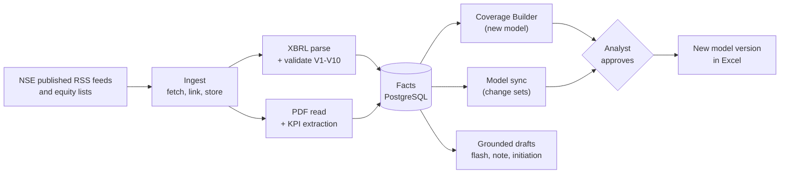

<h1 align="center">Analekh</h1>

<p align="center">
  <b>NSE results in, analyst-approved Excel models and grounded research drafts out.</b>
</p>

<p align="center">
  
  
  
  
  
</p>

Pick any NSE-listed company. Analekh finds its results filings, extracts and validates the
numbers, builds a model from your own template (or updates the model you already keep), writes
to Excel only after you approve, and drafts the results flash, earnings note, initiation, slides
and comps with every number traced to its source.

> **Design document:** *Analekh Technical Design Document v1.0.1*. Section numbers in code
> comments (e.g. "design doc 12.3") refer to it.
>
> **Source control:** GitLab is the source of truth. GitHub is a read-only mirror, updated by CI
> after a green pipeline on `main` (design doc 22.5). Never push to GitHub directly.

## Contents

- [How it works](#how-it-works)
- [Status](#status)
- [Quick start](#quick-start)
- [Development](#development)
- [CI/CD](#cicd)
- [Data rules](#data-rules)

## How it works



- **XBRL wins** over AI-extracted values, and contexts are matched by dates, never by id.
- **Nothing touches a model without approval**, and every write saves a new version; the
  original workbook is never overwritten.
- **Generated text may only contain numbers** from tool results or `calc`; a grounding check
  blocks anything else.

## Status

The code is a **skeleton of all phases**: every engine has a working core and tests. Real NSE
data has now flowed through the universe loader, search and the Phase 0 spike; the remaining
gaps are marked `PHASE n` and `# verify` in the code.

### Next up

1. **Hand-check** 10 values per file from the first spike (Asian Hotels (West), Q4 FY21) against
   the published results PDF, before anything goes into the golden set.
2. **Rerun the spike** during the September-quarter results season (mid to late October) with
   bank and NBFC symbols, to fill the `BANKING` and `NBFC` element tables and widen the Ind-AS
   sample beyond one company.
3. **Parse NSE's `pubDate` format** (`24-Aug-2026 17:39:16`); until then V8 skips with "filing
   date unknown".
4. **Fill the sector map** so each company gets a `results_taxonomy` (Ind-AS, bank, NBFC,
   insurance), which decides how its filings are read.
5. Turn spike files into golden fixtures (`tests/fixtures/golden/`, gitignored) and run
   `analekh golden-test`.
6. Run the workbook reader and template onboarding on real templates and models.

### Tracker

✅ verified on real data &nbsp;·&nbsp; 🟡 built, synthetic tests only &nbsp;·&nbsp; 🔲 to do &nbsp;·&nbsp; ⛔ blocked (reason given)

Keep these tables current in the same merge request as the change, and add a line to the
[dev log](#dev-log).

#### Phase 0 · Spike

| Item | Status | Notes / still needed |
|---|:---:|---|
| NSE published archives reachable | ✅ | From the local development machine |
| `scripts/phase0_spike.py` (lists, two feeds, XBRL parse + validate, element census) | ✅ | First run 2026-10-13; the results feed held only one company |
| Ind-AS element names in `xbrl/elements.py` | ✅ | Seen in real files (one company, 2020-03-31 taxonomy); fallbacks `TotalIncome`, `TotalExpenses` unconfirmed |
| Filing metadata element names (symbol, period, nature, audited) | ✅ | All nine seen |
| SME equity list path and columns | ✅ | 580 companies; two-digit-year dates now parsed |
| Bank, NBFC and insurance element tables | 🔲 | Empty; no such filings in the feed yet |
| Feed `pubDate` format | 🔲 | Format is `DD-Mon-YYYY HH:MM:SS`; not parsed yet, so V8 skips |
| Contexts with the same dates but different values | 🔲 | Seen in a real filing (`OneD` vs `FourD`); parser keeps the first value; decide how to flag |
| Hand-check of spike values against the results PDF | 🔲 | 10 values per file |
| V2 exceptional-items sign convention | 🔲 | Confirm on a filing with exceptional items |
| Kite price pull | ⛔ | `KITE_*` keys |

#### Phase 1 · Data layer

| Item | Status | Notes / still needed |
|---|:---:|---|
| Universe loader | ✅ | 3,186 companies (2,606 main board + 580 SME); renames and delistings not yet seen on real data |
| Company search (API and CLI) | ✅ | Type-ahead: one letter matches the start, two or more match anywhere in ticker or name; paged |
| Web type-ahead search box | 🟡 | Loads more on scroll; lint, tests and build pass; not yet tried against the live API in a browser |
| Watchlist and coverage levels | 🟡 | |
| Feed watcher, polite fetcher, linking, storage | 🟡 | Spike read the live feeds; the watcher itself has not run |
| XBRL parser, validation V1-V9 | 🟡 | Two real files parse; V1-V4, V6, V7, V9 pass; V5 and V8 skip |
| Sector map (`data/sector_map.csv`), Nifty 500 list | 🔲 | Empty; open question 28.4; drives `results_taxonomy` |
| Backfill | 🟡 | First run |

#### Phase 2 · Builder and sync

| Item | Status | Notes / still needed |
|---|:---:|---|
| Workbook understanding engine | 🟡 | Real templates and models |
| Template onboarding + test build | 🟡 | Real templates |
| Built-in NBFC and consumer templates | 🟡 | P&L and KPIs only; balance sheet and cash flow 🔲 |
| Coverage Builder (fill, propose assumptions, finalize) | 🟡 | |
| Discovery and tags, change sets, headless apply | 🟡 | |
| Excel bridge (xlwings) | 🟡 | First run on an analyst's machine |
| Web review screens (change sets, assumptions, models, templates) | 🟡 | |

#### Phase 3 · Document AI

| Item | Status | Notes / still needed |
|---|:---:|---|
| PDF read, page classifier, KPI extraction with quote check, chunking, transcripts | 🟡 | API key, golden set, classifier tuning |
| V10 (XBRL wins over KPI values) in `docs/pipeline.py` | 🔲 | Map KPI names to XBRL names |
| Embeddings | ⛔ | Provider undecided (open question 28.7) |

#### Phase 4 · GenAI outputs

| Item | Status | Notes / still needed |
|---|:---:|---|
| Tools (incl. model reader), calc, grounding check | 🟡 | |
| Report loop (flash, note, initiation), Q&A, Word/PowerPoint writers | 🟡 | Prompt tuning on 10 companies |
| Reports as Celery jobs, files in object storage | 🔲 | Run inline in the API today |
| Web Reports and Q&A screens | 🔲 | Placeholders |

#### Phase 5 · Discovery, IB, polish

| Item | Status | Notes / still needed |
|---|:---:|---|
| Comps | 🟡 | EBITDA, debt, cash, book value not sourced |
| Profile slide, pitch refresh | 🟡 | Branded templates |
| Alerts, Office.js task pane, Streamlit admin | 🟡 | |
| Web Comps and Settings screens | 🔲 | Placeholders |
| Demo | 🔲 | |

#### Platform and CI/CD

| Item | Status | Notes / still needed |
|---|:---:|---|
| GitLab pipeline (lint, tests, web, security scans, image) | ✅ | Green on `main` |
| Staging and production deploys, DAST | ⛔ | Runner tagged `india`, `STAGING_URL`, `PRODUCTION_URL` |
| Python 3.12 everywhere (`.python-version`, CI, Dockerfile) | ✅ | |
| Local stack: Docker Desktop (WSL2), PostgreSQL 16 + pgvector, migrations | ✅ | All 70 tests run locally, none skipped |
| Front-end toolchain: Node 24 (fnm), pnpm workspace for `web/` and `office-addin/` | ✅ | Lint, tests, both builds and the web Docker image pass |
| Excel add-in manifest version | 🔲 | Below 1.0, which Microsoft's validator rejects; bump before publishing |
| Dependency audit (OSV-Scanner, Free tier) | ✅ | Runs on every pipeline, warns on findings |
| Known vulnerabilities: `autobahn` 19.11.2 (pinned by `kiteconnect`) | 🔲 | Client-side use only; override to a fixed version or accept |
| Known vulnerabilities: `adm-zip`, `node-forge` (add-in dev tooling only) | 🔲 | Not in the built add-in; wait for Microsoft's tooling to update |
| Upgrade to Python 3.15 | ⛔ | Windows wheels for pyyaml, playa-pdf, zope-interface, numpy-financial |

### Dev log

Newest first. One line per notable change: what moved, and what it unblocks.

- **2026-10-13** GitLab Free has no dependency scanning, so CI now runs OSV-Scanner on both
  lockfiles (`dependency_audit`, warning only). First run: 27 known vulnerabilities in 5 packages:
  `autobahn` (pinned by `kiteconnect`) and the Excel add-in's dev tooling (see the tracker). Fixed `mirror_to_github`:
  the `alpine/git` image's entrypoint swallowed the job's shell.
- **2026-10-13** Front ends moved to a pnpm workspace (`web/`, `office-addin/`, one lockfile),
  Node 24 pinned in `.node-version`. CI now also builds the Excel task pane. Dependency install
  scripts are denied by default; the three the add-in tooling wanted are listed in
  `pnpm-workspace.yaml`. Added `.dockerignore` so `.env`, exchange data and models never enter a
  Docker build context.
- **2026-10-13** Company search rebuilt as a type-ahead: one letter matches the start of a
  ticker or name, two or more match anywhere, words match in any order ("tata pass"), results
  page with `offset` and the web box loads more on scroll. Look-alike (fuzzy) matches now only
  appear when nothing else matches, so "tata motors" no longer returns Force Motors.
- **2026-10-13** Universe loaded from NSE's published lists: 3,186 companies. Fixed SME listing
  dates (the SME list uses two-digit years).
- **2026-10-13** Local stack up: Docker Desktop on WSL2, PostgreSQL 16 with pgvector and
  pg_trgm, migrations at `0001`. All tests now run locally, none skipped.
- **2026-10-13** First Phase 0 spike run. Universe and SME lists confirmed; the results feed held
  only Asian Hotels (West), two Q4 FY21 Ind-AS files. Validation V1-V4, V6, V7, V9 pass. Ind-AS
  and metadata element names confirmed, `# verify` markers removed. Found: the feed `pubDate`
  format is not parsed (V8 skips), and a filing reuses the quarter's dates for full-year values.
- **2026-10-13** First local development instance. NSE's published archives respond from it,
  so the Phase 0 spike can run. Pinned Python 3.12 in `.python-version` to match CI and the
  Dockerfile. Python 3.15 waits for Windows wheels of four dependencies (see the tracker); to
  upgrade, change `.python-version`, the Dockerfile and `.gitlab-ci.yml` together.
- **2026-10-12** Skeleton of all phases committed; GitLab CI added, first green pipeline on `main`.

## Quick start

### Everything in Docker

```bash
cp .env.example .env            # fill in ANTHROPIC_API_KEY, USER_AGENT and storage keys
docker compose up -d            # postgres, redis, minio, api, worker, beat, web
docker compose exec api alembic upgrade head
docker compose exec api analekh universe load      # published NSE equity lists (Indian network)
docker compose exec api analekh watch MUTHOOTFIN   # deep coverage for one company
docker compose exec api analekh build MUTHOOTFIN --out muthoot.xlsx
```

| | URL |
|---|---|
| API docs | http://localhost:8000/docs |
| Web app | http://localhost:5173 |

Without NSE access, load the universe from a file downloaded by hand:
`analekh universe load --file EQUITY_L.csv`.

### Python on the host, services in Docker

```bash
docker compose up -d postgres            # add redis minio for jobs and file storage
uv sync
uv run alembic upgrade head
uv run analekh universe load
uv run analekh search "tata mo"          # --limit N for more rows
```

> **`.env` hosts:** `.env.example` uses the container names (`postgres`, `redis`, `minio`),
> which only resolve inside Docker. When Python runs on the host, set `DATABASE_URL`,
> `REDIS_URL` and `MINIO_ENDPOINT` to `localhost`.

### Excel bridge (on the analyst's machine)

```bash
uv sync --group bridge
# .env: WATCH_FOLDERS=C:/Models;D:/Coverage  ANALEKH_API=http://<server>:8000
uv run python -m analekh.excel_bridge scan                   # find and identify models
uv run python -m analekh.excel_bridge link Muthoot.xlsx MUTHOOTFIN   # confirm a link
uv run python -m analekh.excel_bridge watch                  # keep models in step
uv run python -m analekh.excel_bridge apply 42 Muthoot.xlsx  # apply an approved change set
```

The bridge talks to the API at `ANALEKH_API`. It never runs macros and never overwrites the
original workbook; `SAVE_MODE=versioned` (the default) writes a new file per apply.

### Excel task pane (optional)

See [`office-addin/README.md`](office-addin/README.md).

## Development

### Prerequisites

| Tool | Version | Used for |
|---|---|---|
| [uv](https://docs.astral.sh/uv/) | latest | Python 3.12 (pinned in `.python-version`), dependencies, running everything |
| Docker Desktop | latest, WSL2 backend on Windows | PostgreSQL 16 + pgvector, Redis, MinIO |
| Node.js | 24 LTS (via [fnm](https://github.com/Schniz/fnm), pinned in `.node-version`) | `web/` and `office-addin/` |
| [pnpm](https://pnpm.io/) | pinned in `package.json` (`npm install -g pnpm`) | Front-end workspace and lockfile |
| Excel | desktop | Excel bridge (xlwings), optional |

LibreOffice and Tesseract are only needed when running the API outside Docker; the Docker
image installs both.

### Everyday commands

```bash
uv sync                  # dev group installs by default
uv run pytest -q         # DB tests need PostgreSQL + pgvector (docker compose up -d postgres)
uv run ruff check . && uv run ruff format --check . && uv run mypy analekh
uv run alembic upgrade head
pnpm install && pnpm dev                 # web app; proxies /api to :8000
pnpm lint && pnpm test && pnpm build     # front-end checks CI runs
pre-commit install       # ruff, gitleaks, no exchange files or workbooks
```

Run ruff, mypy and pytest before every commit. Pinned dependencies live in `uv.lock`, with
`requirements*.txt` exported from it (design doc Appendix G). Front-end types are generated from
the API: `pnpm api-types` (the API must be running). Commit `pnpm-lock.yaml` with any
`package.json` change.

## CI/CD

`.gitlab-ci.yml` runs lint, tests (PostgreSQL + Redis services), the web build, GitLab SAST,
secret detection and container scanning, audits `uv.lock` and `pnpm-lock.yaml` for known
vulnerabilities with OSV-Scanner (`dependency_audit`; GitLab's own dependency scanning needs the
Ultimate tier), and builds the image. Jobs that need
infrastructure run only once it is configured (CI/CD variables, all masked and protected):

| Job | Needs |
|---|---|
| `deploy_staging`, `dast` | `STAGING_URL`, a runner tagged `india` |
| `deploy_production` | `PRODUCTION_URL`, a release tag, manual approval |
| `mirror_to_github` | `GITHUB_MIRROR_TOKEN`, `GITHUB_MIRROR_USER`, `GITHUB_MIRROR_REPO` |

## Data rules

From design doc 23. These are not optional.

- Only NSE's **published RSS feeds**, the **published equity list CSVs** and the files they
  link to, at the published TTL. Never NSE's internal JSON endpoints, never crawling.
  `analekh/ingest/http.py` enforces a host allow-list.
- Raw exchange files, user models and keys are **never committed** (`.gitignore` and the
  pre-commit hooks cover `data/`, `import/`, `out/`, `*.xlsx`, `.env`).
- Get written confirmation from NSE, or license a feed, before any public or commercial use.
- No buy/sell/hold ratings or target prices in anything shared.
